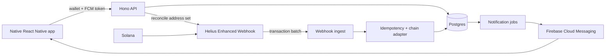

# WhoAped architecture

## Recommendation

Use Postgres, with Neon as the first host.

The workload is append-heavy but it is not a document-store-shaped workload. WhoAped needs deterministic webhook deduplication, wallet-to-user joins, chronological pagination, device-token fanout, retryable notification jobs, and later retention/partitioning. Postgres handles all of those directly. Firestore is attractive for an early mobile prototype, but per-document read/write billing and denormalized fanout become awkward as transaction volume rises.

Neon is a good cheap starting point because compute and storage scale independently and idle environments can scale to zero. For a continuously busy production tracker, scale-to-zero matters less; Postgres portability matters more. If Neon stops being economical, the same schema moves to RDS, AlloyDB, Crunchy Bridge, or another Postgres provider.

## Data flow

The mobile contract only knows `Wallet`, `Activity`, and `Chain`. Provider payloads never leak into the app. The backend's `ChainAdapter` extracts watched addresses and maps provider events into the shared activity vocabulary. An EVM adapter can therefore consume Alchemy, QuickNode, or another provider later without changing the feed UI or transaction tables.

## Idempotency and ordering

- Raw Helius events are unique on `(provider, external_id)`.
- Feed events are unique on `(wallet_id, chain, tx_hash, event_index)`.
- Notification jobs are unique on `(device_token_id, transaction_id)`.
- Feed reads use `(user_id, occurred_at desc)` and should move from offset to cursor pagination before public launch.

This makes webhook retries harmless. A transfer between two watched wallets intentionally creates one feed event per watched wallet because the user-facing direction differs.

## Scaling the transaction store

The initial table is deliberately compact and unpartitioned. With the covering B-tree feed index and a BRIN time index, this is simpler and efficient through the early tens of millions of rows, assuming payload JSON stays small. Before the hot index set outgrows memory:

1. Partition `transactions` monthly by `occurred_at`.
2. Retain normalized activity according to product tier; archive cold history to object storage as Parquet if indefinite history is required.
3. Delete raw `webhook_events` after 7 days once replay tooling exists.
4. Put push jobs on Cloudflare Queues, SQS, or QStash when inline delivery affects webhook latency.
5. Add a read replica only after query metrics show it is needed.

Do not introduce Redis initially. Postgres already provides the uniqueness constraints and `SKIP LOCKED` job claiming this MVP needs.

## Helius webhook strategy

For the MVP, one enhanced webhook tracks the distinct Solana address set. Adding a wallet writes Postgres first and then reconciles Helius from the complete desired set, avoiding lost addresses during normal concurrent additions.

At higher scale, shard addresses across multiple Helius webhooks. Store `provider_subscription_id` and shard assignment per wallet, update shards asynchronously, and cap each shard below the provider limit. The ingest contract and idempotency keys remain unchanged.

## Cost progression

- MVP: Neon free/entry tier + one small Node service + existing Helius plan + Firebase Cloud Messaging.
- Growing: paid Neon with capped autoscaling, webhook service kept warm, scheduled push worker.
- High volume: monthly partitions, object-storage archive, webhook shards, durable queue, separate ingest and read API deployments.

The first dollars should go to reliable ingestion and database observability, not a larger RPC plan or streaming infrastructure. Helius webhooks satisfy the product's latency requirement without gRPC/LaserStream complexity.

## Security

- Only public wallet addresses are accepted. No wallet connection or key custody exists.
- Anonymous sessions store only a SHA-256 token hash server-side.
- The Helius endpoint uses an unguessable path secret and deduplicates every payload.
- Secrets remain server-side; `HELIUS_API_KEY` and Firebase Admin credentials are never shipped in the mobile binary.
- Before launch: add rate limits, device attestation, secret rotation, webhook IP/auth validation where supported, and account recovery.
