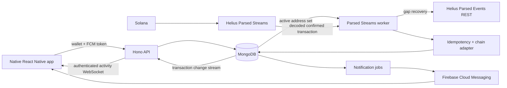

# WhoAped architecture

## Recommendation

Use MongoDB as the primary store. Collections match the product boundaries: users, sessions, wallets, normalized transactions, short-lived ingestion events, device tokens, notification jobs, and pipeline checkpoints.

MongoDB is not inherently better than Postgres for this workload, but it is now the chosen operational standard. Correctness is preserved with compound unique indexes for ingestion events, normalized transactions, active wallets, and notification jobs. Raw ingestion payloads expire after seven days through a TTL index. The API performs the small wallet-to-activity lookup in application code; cursor pagination should be added before feed volume grows.

## Data flow

The mobile contract only knows `Wallet`, `Activity`, and `Chain`. Provider payloads never leak into the app. The backend's `ChainAdapter` extracts watched addresses and maps decoded provider events into the shared activity vocabulary. An EVM adapter can therefore consume Alchemy, QuickNode, or another provider later without changing the feed UI or transaction tables.

The foreground Activity feed is event-driven rather than polled. Each API instance watches new transaction inserts and fans an activity only to WebSocket clients authenticated for that transaction's user. The app reconciles once after connecting or returning to the foreground to cover disconnect gaps. FCM handles background notification delivery and also triggers a silent reconciliation when a notification is received or opened. Only an explicit user pull displays the native refresh indicator.

## Public tracking count

`GET /public/stats` needs no session and returns only `uniqueWalletsTracked` and `asOf` (an ISO 8601 UTC timestamp). The count deduplicates by Solana wallet address across the mobile app and Telegram. An address counts if at least one non-deleted, active watch belongs to an account that is not paused, in cooldown, or waiting to resume. Discovery profiles and protocol position addresses are not counted unless the address was explicitly added as an eligible wallet watch.

Each API replica caches its result for five minutes and shares one refresh across concurrent requests. Clients should treat a `503` as unavailable, not as a zero count.

## Idempotency and ordering

- Short-lived ingestion events are unique on `(provider, externalId)`.
- Feed events are unique on `(walletId, chain, txHash, eventIndex)`.
- Notification jobs are unique on `(deviceTokenId, transactionId)`.
- Every new Solana transaction stores its slot. The worker persists the last completely processed slot per address in `pipeline_checkpoints`.
- Feed reads use `(user_id, occurred_at desc)` and should move from offset to cursor pagination before public launch.

MongoDB upserts make duplicate stream deliveries and REST backfill overlap harmless. `findOneAndUpdate` atomically leases pending push jobs so concurrent drain calls cannot claim the same job. A transfer between two watched wallets intentionally creates one feed event per watched wallet because the user-facing direction differs.

## Scaling the transaction store

The initial collections use access-pattern indexes for user feed, wallet history, chain slot, and notification leases. Before the hot working set outgrows memory:

1. Move to a managed MongoDB replica set if the MVP starts on the single DigitalOcean server.
2. Retain normalized activity according to product tier; archive cold history to object storage if indefinite history is required.
3. Shard `transactions` only after measured volume requires it; a likely key begins with `userId` or a stable user bucket.
4. Put push jobs on a dedicated queue when database polling becomes a bottleneck.
5. Add read capacity only after query metrics show it is needed.

Do not introduce Redis initially. MongoDB provides the required uniqueness constraints and atomic job leasing for this MVP.

## Helius Parsed Streams strategy

The worker polls the distinct active Solana address set every five seconds. It creates one subscription per 100 addresses, up to 25 subscriptions (2,500 addresses) on each WebSocket connection, matching Helius's beta limits. Address changes rebuild the connection set. MongoDB remains the source of truth, so API instances never need to coordinate socket state.

Parsed Streams delivers at most once and has no replay. Each connection sends JSON-RPC `ping` messages to survive the ten-minute idle timeout. On reconnect, the worker compares its persisted slot checkpoint with the current slot and queries Parsed Events history for every address in that connection over the missing slot range. Writes and notifications remain idempotent.

Reconnect recovery runs separately from the ordered live queue. While history is incomplete, live transactions can be delivered, but live pings cannot advance the checkpoint past the gap. History requests time out and retry without dropping a healthy socket; a closed socket cancels its history requests.

The worker's `solana_stream_timing_sample` and `solana_stream_timing_slow` logs distinguish block-to-WebSocket time, local queue wait, and transaction processing time. Block-to-WebSocket time is approximate; if the frame has no block timestamp, a rate-limited RPC sample looks it up off the delivery path. A saved live ingestion event also records its exact `streamReceivedAt` and `streamProcessingStartedAt` timestamps for signature-level diagnosis.

Run one worker replica initially. Multiple replicas are data-safe but waste Helius connections and database writes. At higher scale, assign stable address shards to workers with MongoDB lease documents rather than relying on process-local connection indexes.

## Cost progression

- MVP: DigitalOcean App Platform with one HTTP service, exactly one persistent stream worker, DigitalOcean Managed MongoDB, the existing Helius plan, and Firebase Cloud Messaging.
- Growing: larger App Platform components, MongoDB standby/read capacity, worker shard leases, and a durable push queue when needed.
- High volume: managed MongoDB scaling or sharding, object-storage archive, stable address sharding, and separate ingest/read deployments.

The first dollars should go to reliable ingestion, backups, and database observability. Parsed Streams avoids raw transaction decoding and gRPC infrastructure, but its persistent socket means the worker cannot scale to zero.

## Security

- Only public wallet addresses are accepted. No wallet connection or key custody exists.
- Anonymous sessions store only a SHA-256 token hash server-side.
- Secrets remain server-side; `HELIUS_API_KEY`, optional `JUPITER_API_KEY`, and Firebase Admin credentials are never shipped in the mobile binary.
- Solana token metadata resolves from Jupiter's verified token data first, falls back to Helius DAS/on-chain metadata, and is cached per mint in MongoDB.
- Before launch: add rate limits, device attestation, secret rotation, webhook IP/auth validation where supported, and account recovery.
