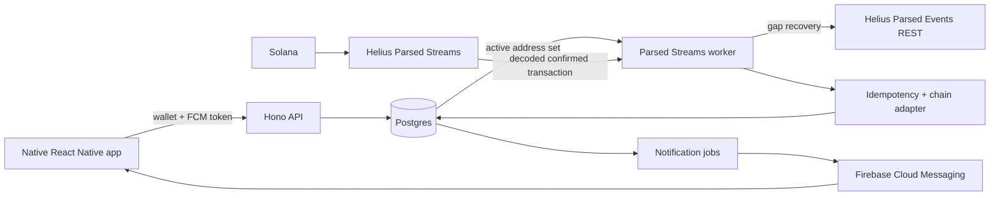

# WhoAped architecture

## Recommendation

Use Postgres, with Neon as the first host.

The workload is append-heavy but it is not a document-store-shaped workload. WhoAped needs deterministic webhook deduplication, wallet-to-user joins, chronological pagination, device-token fanout, retryable notification jobs, and later retention/partitioning. Postgres handles all of those directly. Firestore is attractive for an early mobile prototype, but per-document read/write billing and denormalized fanout become awkward as transaction volume rises.

Neon is a good cheap starting point because compute and storage scale independently and idle environments can scale to zero. For a continuously busy production tracker, scale-to-zero matters less; Postgres portability matters more. If Neon stops being economical, the same schema moves to RDS, AlloyDB, Crunchy Bridge, or another Postgres provider.

## Data flow

The mobile contract only knows `Wallet`, `Activity`, and `Chain`. Provider payloads never leak into the app. The backend's `ChainAdapter` extracts watched addresses and maps decoded provider events into the shared activity vocabulary. An EVM adapter can therefore consume Alchemy, QuickNode, or another provider later without changing the feed UI or transaction tables.

## Idempotency and ordering

- Short-lived ingestion events are unique on `(provider, external_id)`.
- Feed events are unique on `(wallet_id, chain, tx_hash, event_index)`.
- Notification jobs are unique on `(device_token_id, transaction_id)`.
- Every new Solana transaction stores its slot. Each stream connection persists its last completely processed slot in `pipeline_checkpoints`.
- Feed reads use `(user_id, occurred_at desc)` and should move from offset to cursor pagination before public launch.

This makes duplicate stream deliveries and REST backfill overlap harmless. A transfer between two watched wallets intentionally creates one feed event per watched wallet because the user-facing direction differs.

## Scaling the transaction store

The initial table is deliberately compact and unpartitioned. With the covering B-tree feed index and a BRIN time index, this is simpler and efficient through the early tens of millions of rows, assuming payload JSON stays small. Before the hot index set outgrows memory:

1. Partition `transactions` monthly by `occurred_at`.
2. Retain normalized activity according to product tier; archive cold history to object storage as Parquet if indefinite history is required.
3. Delete raw `ingestion_events` after 7 days once replay tooling exists.
4. Put push jobs on Cloudflare Queues, SQS, or QStash when inline delivery affects webhook latency.
5. Add a read replica only after query metrics show it is needed.

Do not introduce Redis initially. Postgres already provides the uniqueness constraints and `SKIP LOCKED` job claiming this MVP needs.

## Helius Parsed Streams strategy

The worker polls the distinct active Solana address set every five seconds. It creates one subscription per 100 addresses, up to 25 subscriptions (2,500 addresses) on each WebSocket connection, matching Helius's beta limits. Address changes rebuild the connection set. The database remains the source of truth, so API instances never need to coordinate socket state.

Parsed Streams delivers at most once and has no replay. Each connection sends JSON-RPC `ping` messages to survive the ten-minute idle timeout. On reconnect, the worker compares its persisted slot checkpoint with the current slot and queries Parsed Events history for every address in that connection over the missing slot range. Writes and notifications remain idempotent.

Run one worker replica initially. Multiple replicas are data-safe but waste Helius connections and database writes. At higher scale, assign stable address shards to workers with leases in Postgres rather than relying on process-local connection indexes.

## Cost progression

- MVP: Neon free/entry tier + scale-to-zero HTTP API + one minimum-size always-on stream worker + existing Helius paid plan + Firebase Cloud Messaging.
- Growing: paid Neon with capped autoscaling, leased stream-worker shards, durable push queue.
- High volume: monthly partitions, object-storage archive, stable address sharding, and separate ingest/read deployments.

The first dollars should go to reliable ingestion and database observability. Parsed Streams avoids raw transaction decoding and gRPC infrastructure, but its persistent socket means the worker cannot scale to zero.

## Security

- Only public wallet addresses are accepted. No wallet connection or key custody exists.
- Anonymous sessions store only a SHA-256 token hash server-side.
- Secrets remain server-side; `HELIUS_API_KEY` and Firebase Admin credentials are never shipped in the mobile binary.
- Before launch: add rate limits, device attestation, secret rotation, webhook IP/auth validation where supported, and account recovery.
